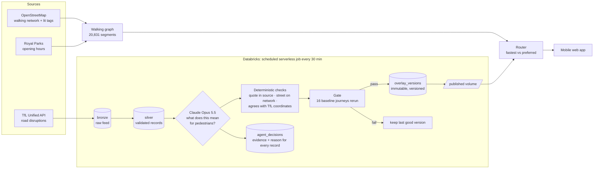

# Lantern

**Night-time walking routes for London students, kept current by an autonomous agent.**

It is 22:30 and a first-year is walking from Imperial's South Kensington campus to Wilson House in Paddington.
Lantern shows her two routes side by side: the fastest, and one that trades a minute or two for streets that are
recorded as lit, near other streets and not enclosed. It says what the trade costs, what it is based on and what
it does not know. Behind it, an agent running on Databricks reads Transport for London's disruption feed every
30 minutes, works out which records actually affect someone on foot, proves it against the source text and the
map, reruns a set of test journeys, and only then publishes a routing update that the app picks up by itself.

Imperial AI Society Hackathon, 14-15 November 2026. Track: **Autonomous Agents**. Bounties: **Databricks**, **Figma**.

| Route comparison (live) | After an agent update (replay) |
|---|---|
|  |  |

Lantern describes observed street conditions. It does not predict crime and does not say any route is safe.

## How it fits together



- **Router** (`lantern/routing.py`): Dijkstra on demand over the graph, twice per request. No routes are precomputed.
- **Cost model** (`lantern/cost.py`): walking time plus weighted time exposed to four observed conditions. See below.
- **Agent** (`lantern/agent/`): one bounded run with three outcomes: published, no change, or failed with the last
  good version left in place.
- **Overlay** (`lantern/overlay.py`): the contract between agent and app. A versioned JSON document listing
  segments to close or penalise, each with source, evidence quote, validity window and the test results that gated it.
- **App** (`web/`, `lantern/api.py`): map-first mobile web app (installable PWA). It only reads.
- **Design** ([Figma file](https://www.figma.com/design/1GlEqbaZG7xphZQwJ98Tic), `docs/DESIGN.md`): variables,
  12 components and three screens for the route comparison flow. The app's colours, radii, spacing and type are
  generated from the Figma variables (`design/figma-tokens.json` to `web/tokens.css`).

## Run it

Requires Python 3.11+.

```bash
python -m venv .venv
.venv/Scripts/python -m pip install -r requirements.txt      # macOS/Linux: .venv/bin/python
.venv/Scripts/python -m uvicorn lantern.api:app --port 8000
```

Open http://localhost:8000 (add `?t=2230` for a 22:30 departure). With no configuration the app uses a local
store under `var/` and the built graph in `data/processed/`, so it works offline apart from map tiles.

```bash
python scripts/agent_run.py --replay 1     # run the agent on the replay scenario (local store)
python scripts/agent_run.py --replay 2     # the burst main is fixed: closure withdrawn
python scripts/agent_run.py                # run on the live TfL feed
python -m pytest -q                        # 47 tests, no network
python scripts/sensitivity.py              # regenerate docs/SENSITIVITY.md
python scripts/eval_agent.py               # regenerate docs/EVALUATION.md (calls Claude, about $1.60)
python scripts/setup_data.py               # rebuild the graph from OpenStreetMap
python scripts/build_tokens.py             # regenerate web/tokens.css from the Figma token export
node scripts/capture_screens.mjs 01-route-comparison "t=2230"   # phone-size screenshot via headless Chrome
```

### Configuration

Copy `.env.example` to `.env` (git-ignored). Nothing secret is ever committed, logged or sent to the browser.

| Name | Where | Purpose |
|---|---|---|
| `ANTHROPIC_API_KEY` | `.env` | Claude judgment step for local agent runs. Without it the agent falls back to keyword rules and labels every decision `rules-fallback`. |
| `TFL_APP_KEY` | `.env`, optional | Raises TfL rate limits. The feed works without it. |
| `LANTERN_STORE` | `.env` | `local` (default) or `databricks` to read the overlay the Databricks job published. |
| `DATABRICKS_PROFILE` | `.env` | Name of the Databricks CLI profile (OAuth, `databricks auth login`). No token is stored. |
| `lantern/anthropic_api_key` | Databricks secret scope | Claude key for the scheduled job. |

## The routing model

Every segment *e* has a walking time τₑ = lengthₑ / 1.34 m/s (stairs at 0.6 of that speed). A route's cost is

```
C(route) = Σₑ τₑ · (1 + λ · Σₖ wₖ · xₖ,ₑ)          [equivalent seconds]
```

where xₖ,ₑ ∈ [0, 1] is how much of segment *e* is exposed to condition *k*. λ = 0 gives the **Fastest** route;
λ = 1 gives **Better lit**. Park closures and agent-published closures are hard constraints on both.

| Condition *k* | xₖ,ₑ | Source and coverage | wₖ |
|---|---|---|---:|
| `unlit` | 1 if OSM `lit=no`; 0 if `lit=yes`; if unrecorded, P(unlit \| street group) estimated from recorded segments nearby | OSM `lit` tag, recorded on 61% of network length | 1.0 |
| `isolated` | 1 if no vehicle-carrying street within 25 m | computed from geometry, 100% | 0.5 |
| `enclosed` | 1 for an underpass or tunnel, 0.5 for a covered passage | OSM `tunnel` / `covered` | 1.0 |
| `quiet` | 1 if no main road within 25 m and no pub, bar, restaurant or takeaway within 50 m | OSM road class and `amenity` (a proxy; opening hours unverified) | 0.2 |
| `disrupted` | 1 on segments the agent has published as restricted | agent overlay | 1.0 |

A weight is a stated trade-off, in plain units: with w = 1, one minute on an unlit segment counts the same as two
minutes on a lit one. **The weights are not fitted to outcomes and the score is not a probability of anything.**
We found no outcome data with a usable exposure denominator for this area (see `docs/DATA.md`), so we did not
pretend to have a calibrated risk model. What we can defend is in `docs/MODEL.md`: the formulation, the rationale
for each factor, how missing lighting is handled, and the limits.

What the numbers do under perturbation (`docs/SENSITIVITY.md`, 56 journeys at 22:30):

- At λ = 1 the average journey is 67 s (3.5%) longer than the fastest and spends 97% less time on segments that are
  unlit or expected to be, and 89% less time away from any street. Raising λ to 4 adds another 99 s for a further
  3%: the default takes most of what is available.
- Halving or doubling any single weight keeps 95% of journeys in the same corridor on average (worst case 82%).
- Missing lighting data is the largest uncertainty. Assuming every unrecorded segment is unlit keeps only 68% of
  journeys in the same corridor. The app therefore shows the unrecorded share of every route and never colours an
  unrecorded segment as lit.

## The agent

One run (`lantern/agent/run.py`) does this, the same code locally and in the Databricks job:

1. **Fetch** the TfL road disruption feed. Fewer than 20 records is treated as an outage, not as "everything cleared".
2. **Validate** each record (required fields, timestamps, geometry) and keep those in the demo area.
3. **Screen** for staleness: ended, not active, or starting more than 12 hours ahead.
4. **Judge** (Claude Opus 5.5, structured output): what does the text establish for pedestrians? It must return an
   impact class, whether the text is explicit, a verbatim quote, whether pedestrians can still get past, and the
   street and extent. A vehicle closure or a station closure alone is "none".
5. **Verify the claim** without a model: the quote must appear in the source text and mention pedestrians; the
   street must exist in the walking network; cross streets must resolve to junctions; the matched stretch must lie
   within 150 m of the coordinates TfL published; the stretch must be bounded.
6. **Decide the action.** Segments are closed only if the source says pedestrians cannot pass or the closed side is
   resolved. An explicit closure of one footway becomes a restriction (a penalty), not a severed street.
7. **Resolve conflicts.** If two records claim the same segments, the more recently modified one wins.
8. **Gate.** Rerun 16 baseline journeys (8 origin-destination pairs at 22:30 and 00:30). Every route must still
   exist, be a connected walk avoiding closed segments, and be at most 1.5x (or 5 minutes) slower. Entries that
   break a journey are rejected one by one.
9. **Publish** a new immutable overlay version if anything changed; otherwise record a heartbeat. Entries carry
   their own `valid_to`, so they expire in the app even if the agent stops. Records that leave the feed are withdrawn.
10. **Log** a decision for every in-area record: source URL, timestamps, evidence, reason, matched segments, tests.

| Situation | What happens |
|---|---|
| Vehicle-only or station closure | `ignore_not_pedestrian` |
| Suggestive but not explicit ("pedestrians should take care") | `reject_uncertain`, held back |
| Quote not found in the source | `reject_unverified_evidence` |
| Text names one street, coordinates are elsewhere | `reject_location` |
| Record ended, or update says cleared | `reject_stale` / `ignore_cleared` |
| Conflicting records on the same segments | newest wins, other gets `reject_conflict` |
| Closure would strand a baseline journey | `reject_validation` for that entry |
| Feed down, feed truncated, exception anywhere | run `failed`, previous version stays published |
| Claude unavailable | already-verified unchanged entries are carried; new records are held |

## Databricks

The agent is a scheduled serverless notebook job (`databricks/lantern_agent_job.py`, job `lantern-agent`,
every 30 minutes). Everything the app knows about disruptions comes from what this job writes.

| Object in `workspace.lantern` | Contents |
|---|---|
| `bronze_tfl_road_disruptions` | every raw record from every run, as fetched |
| `silver_disruptions` | validated, normalised records with `valid`, `reject_reason`, `in_area` |
| `agent_decisions` | one row per record per run: decision, reason, evidence quote, matched segments, assessment JSON |
| `agent_runs` | one row per run: status, versions before and after, counts, gate results, error |
| `overlay_versions`, `overlay_entries` | immutable published versions; `current_overlay_entries` view |
| volume `published` | `overlay_latest.json`, `heartbeat.json`, `last_run.json`: the serving copy the app reads over the Files API |
| volume `code` | `lantern_bundle.zip`: this repository's package and data, uploaded by the deploy script |

```bash
databricks auth login --host <workspace-url> --profile walknight
databricks secrets create-scope lantern --profile walknight
databricks secrets put-secret lantern anthropic_api_key --profile walknight
python scripts/databricks_deploy.py deploy --unpause    # upload bundle + notebook, create the scheduled job
python scripts/databricks_deploy.py run --wait          # one live run now
python scripts/databricks_deploy.py run --replay 1 --wait
python scripts/databricks_deploy.py status              # last run, published overlay, run counts
```

Set `LANTERN_STORE=databricks` in `.env` and the app reads the published volume, caching the last good overlay
locally in case Databricks is unreachable.

## Evidence that it works

| Check | Result | Where |
|---|---|---|
| Automated tests (routing validity, event matching, expiry, withdrawal, failed updates, gate, API, store) | 47 pass, no network | `tests/` |
| Agent judgment vs hand labels, 113 real + 8 synthetic records | 121/121 on the actionable decision; 11/11 quotes verbatim; 16/16 same on a second pass | `docs/EVALUATION.md` |
| Databricks end to end | live and replay runs published to Delta and read back by the app | `python scripts/databricks_deploy.py status` |
| Sensitivity of recommendations | see above | `docs/SENSITIVITY.md` |

The evaluation's limits are stated in the document: one feed snapshot, few positives, labels that are not blind.

## What is real and what is simulated

- **Real:** the walking network, lighting tags and park hours; the live TfL feed; Claude's judgments; the Databricks
  job, tables and schedule; every route the app draws.
- **Simulated:** the eight `REPLAY-*` records in `data/fixtures/replay_scenario.json` are synthetic, written in TfL's
  phrasing and placed on real streets, because the live feed contained no pedestrian-relevant event in the demo area
  during the hackathon. Replay runs are marked `mode: replay` in the overlay, tagged REPLAY in the app and
  SYNTHETIC in the decision log, and a live run withdraws them.
- **Not built:** turn-by-turn navigation, live location, accounts, arbitrary start points (the app offers eight
  named places), and any use of crime or casualty data in the score.

## Limitations

- Lighting comes from volunteer-mapped tags and is unrecorded on 39% of the network. A "lit" tag says a street has
  lighting, not that every lamp works tonight.
- The weights are judgments, stated openly. Different people would choose differently; the sensitivity analysis
  shows how much that matters.
- Coverage is one 3.8 km by 3.5 km area. The pipeline has no area-specific logic beyond the bounding box and the
  two parks' opening hours.
- TfL's road feed is written for drivers and mostly covers the roads TfL manages. Borough roadworks are not in it.
- Walking times ignore waits at crossings.

## Attribution

- Walking network and lighting: © OpenStreetMap contributors, ODbL 1.0. `data/processed/graph.json.gz` is a
  derived database under the same licence.
- Disruptions: Powered by TfL Open Data. Contains OS data © Crown copyright and database rights 2016 and Geomni
  UK Map data © and database rights [2019].
- Park hours: The Royal Parks. Basemap: OpenFreeMap, © OpenMapTiles, data © OpenStreetMap contributors.
- Map rendering: MapLibre GL JS. Typeface: Inter (SIL Open Font License), loaded from Google Fonts.
- Built during the hackathon with Claude Code as the implementation agent; the agent's judgment step uses the
  Claude API (`claude-opus-5-5`).

## Repository layout

```
lantern/            package: graph, cost model, routing, overlay, TfL client, API, stores
lantern/agent/      assess (Claude), match (location), validate (gate), run (orchestration), replay
web/                mobile web app (no build step)
databricks/         job notebook and connectivity probes
scripts/            data setup, agent runs, Databricks deploy, sensitivity, evaluation
tests/              47 tests
design/             token export from the Figma file
data/               built graph and fixtures (see docs/DATA.md)
docs/               MODEL, DATA, DESIGN, SENSITIVITY, EVALUATION, DEMO_SCRIPT, DEVPOST
```
