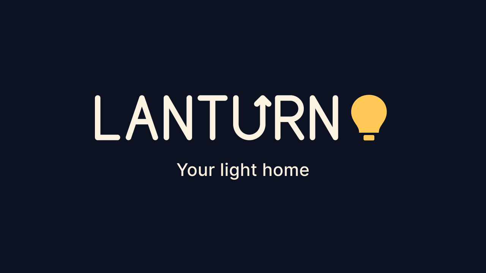
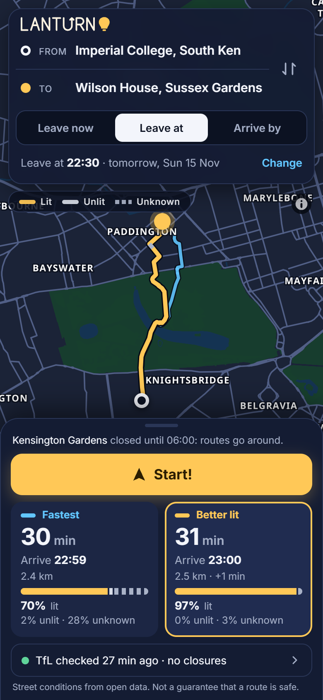
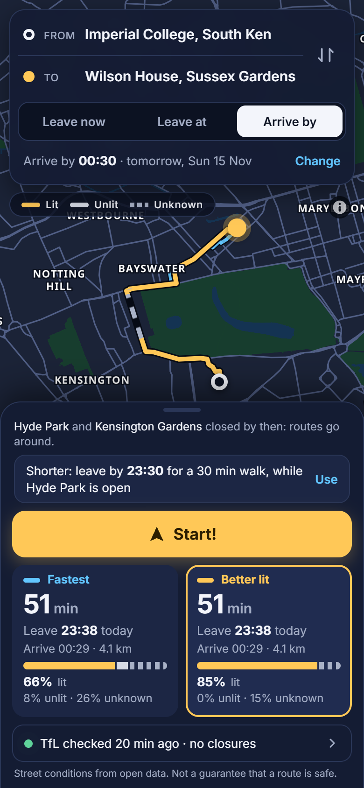
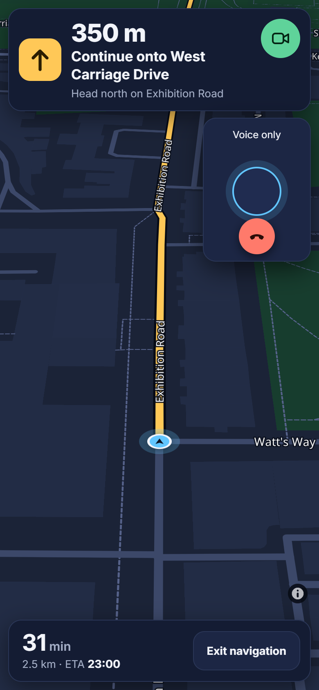
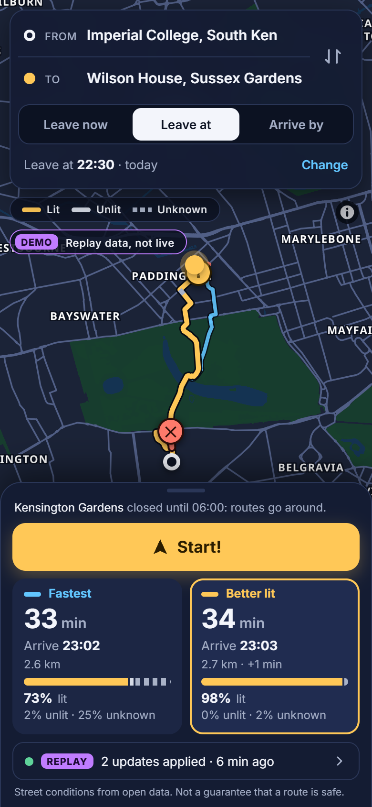
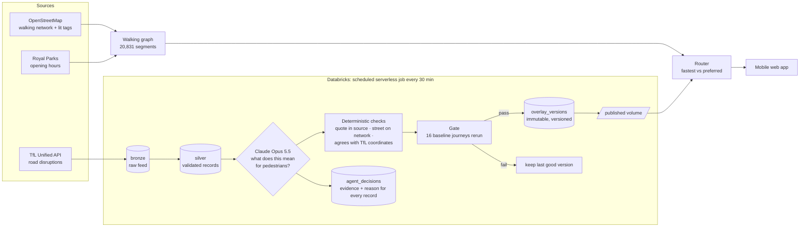

# Lanturn



**Your light home.** Night-time walking routes for London students, kept current by an autonomous agent.

It is 22:30 and a first-year is walking from Imperial's South Kensington campus to Wilson House in Paddington.
Lanturn shows her two routes side by side: the fastest, and one that trades a minute or two for streets that are
recorded as lit, near other streets and not enclosed. It says what the trade costs, what it is based on and what
it does not know. Behind it, an agent running on Databricks reads Transport for London's disruption feed every
30 minutes, works out which records actually affect someone on foot, proves it against the source text and the
map, reruns a set of test journeys, and only then publishes a routing update that the app picks up by itself.

She can leave now, leave at a time, or ask to arrive by a time; press **Start!** for a navigation preview with
the first instruction taken from the real route; and, from there, start a video call with a walking companion
(a live Synthesia avatar) who keeps her company on the way. The companion is a separate feature from the agent.

Lanturn describes observed street conditions. It does not predict crime and does not say any route is safe.

| Compare routes (live data) | Arrive by, across midnight | Navigation with the live companion | Agent replay (demo mode) |
|---|---|---|---|
|  |  |  |  |

## Hackathon entry

Imperial AI Society Hackathon, 14-15 November 2026.

- **Track:** Autonomous Agents.
- **Track bounties:** Databricks, and Best Use of Synthesia.
- **Cross-track bounty:** Best-Designed AI Product (Figma).

| Sponsor technology | How Lanturn uses it |
|---|---|
| **Databricks** | Runs the scheduled TfL disruption agent as a serverless job every 30 minutes, records every record, decision and run in Delta tables, and publishes a versioned routing overlay that the router consumes. The app has no other source of disruption data. See [Databricks](#databricks). |
| **Synthesia** | Renders the live conversational avatar in the navigation preview through the Interactive Avatar API. LiveKit carries the call (and provides speech recognition and voice), and Claude Haiku 5.5 handles the conversation. See [Walking companion](#walking-companion). |
| **Figma** | The [Lanturn Figma file](https://www.figma.com/design/1GlEqbaZG7xphZQwJ98Tic) contains the editable route comparison, disruption evidence, time and navigation screens, the components they are built from, and the logo. Its variables supply the visual tokens (colours including the map, radii, spacing, type) that the frontend is generated from. See [docs/DESIGN.md](docs/DESIGN.md). |

## How it fits together



- **Router** (`lantern/routing.py`): Dijkstra on demand over the graph, twice per request. No routes are precomputed.
- **Cost model** (`lantern/cost.py`): walking time plus weighted time exposed to four observed conditions. See below.
- **Agent** (`lantern/agent/`): one bounded run with three outcomes: published, no change, or failed with the last
  good version left in place.
- **Overlay** (`lantern/overlay.py`): the contract between agent and app. A versioned JSON document listing
  segments to close or penalise, each with source, evidence quote, validity window and the test results that gated it.
- **App** (`web/`, `lantern/api.py`): map-first mobile web app (installable PWA). It only reads.
- **Timing** (`lantern/timing.py`): Leave now, Leave at and Arrive by on a 24-hour London clock. Arrive by
  searches for the latest departure whose own route still arrives on time, because closures make a route's
  duration depend on when you set off, and re-checks the answer against the router.
- **Navigation preview** (`lantern/navigation.py`): start heading and turn instructions derived from the route's
  geometry and OpenStreetMap street names. The position stays at the start; it is a preview, not live guidance.
- **Walking companion** (`lantern/companion.py`, `companion/`): a live avatar video call inside navigation.
  See "Walking companion" below.
- **Design** ([Figma file](https://www.figma.com/design/1GlEqbaZG7xphZQwJ98Tic), `docs/DESIGN.md`): variables,
  components and screens for planning, navigation and the agent evidence. The app's colours (including the
  basemap), radii, spacing and type are generated from the Figma variables (`design/figma-tokens.json` to
  `web/tokens.css`).

## Run it

From a clean clone, with Python 3.11 or newer. No account or key is needed for the steps in this section.

```bash
git clone https://github.com/sivasatyanb/lanturn.git
cd lanturn
python -m venv .venv
.venv/Scripts/python -m pip install -r requirements.txt      # macOS/Linux: .venv/bin/python
.venv/Scripts/python -m pytest -q                            # 67 tests, no network
.venv/Scripts/python -m uvicorn lantern.api:app --port 8000
```

Open http://localhost:8000 (in a desktop browser, use a phone-sized window, about 390 px wide). The walking
graph is included in the repository (`data/processed/graph.json.gz`), so routing works immediately; only the map
tiles and fonts are fetched from the internet.

| Link | What it opens |
|---|---|
| `/` | normal planning on the **live** overlay |
| `/?t=2230` | leave at 22:30 |
| `/?arrive=0030` | arrive by 00:30 |
| `/?demo=1` | **demo mode**: the labelled replay data path |
| `/?demo=1&open=agent` | demo mode with the agent's decisions open |

### What works where

| Feature | Clean clone, no credentials | Needs server-side credentials |
|---|---|---|
| Fastest and Better lit routes, lighting breakdown, park closing times | yes | |
| Leave now, Leave at, Arrive by (24-hour picker) | yes | |
| Navigation preview (heading, first instruction, time, distance, ETA) | yes | |
| Tests, sensitivity analysis | yes | |
| Agent on the **live TfL feed**, run by hand | yes: `python scripts/agent_run.py` fetches the public feed. Without a Claude key the judgment step falls back to keyword rules and labels every decision `rules-fallback` | `ANTHROPIC_API_KEY` for the Claude judgment |
| Agent on the **labelled synthetic replay** | yes: `python scripts/agent_run.py --replay 1`, then open `/?demo=1` (or press Replay in demo mode) | `ANTHROPIC_API_KEY` for the Claude judgment |
| Scheduled agent every 30 minutes, Delta tables, published overlay | | a Databricks workspace and CLI login, plus the Claude key in a Databricks secret scope |
| Walking companion video call | the call button reports that the companion is not set up; everything else keeps working | `LIVEKIT_URL`, `LIVEKIT_API_KEY`, `LIVEKIT_API_SECRET`, `SYNTHESIA_API_KEY`, `ANTHROPIC_API_KEY`, and the worker in `companion/` |

Without configuration the app keeps its state in a local store under `var/` and starts with an empty overlay,
so the status line reads "TfL check has not run yet" until you run the agent once.

```bash
python scripts/agent_run.py                # one agent run on the live TfL feed (local store)
python scripts/agent_run.py --replay 1     # replay: a burst main closes Exhibition Road (demo path only)
python scripts/agent_run.py --replay 2     # replay: the main is fixed, closure withdrawn
python scripts/sensitivity.py              # regenerate docs/SENSITIVITY.md
python scripts/eval_agent.py               # regenerate docs/EVALUATION.md (calls Claude, about $1.60)
python scripts/setup_data.py               # rebuild the walking graph from OpenStreetMap (Overpass API)
python scripts/build_tokens.py             # regenerate web/tokens.css from the Figma token export
python scripts/build_brand.py              # regenerate the logo: web/logo.svg, web/icon.svg, design/brand/
node scripts/capture_screens.mjs 01-route-comparison "t=2230"   # phone-size screenshot via headless Chrome
```

### Configuration

Copy `.env.example` to `.env` (git-ignored) and fill in only what you need. Secrets are read on the server and
by the companion worker; nothing secret is committed, logged or sent to the browser.

| Name | Where | Purpose |
|---|---|---|
| `ANTHROPIC_API_KEY` | `.env` | Claude judgment step for local agent runs, and the companion's conversation. |
| `TFL_APP_KEY` | `.env`, optional | Raises TfL rate limits. The feed works without it. |
| `LANTERN_STORE` | `.env` | `local` (default) or `databricks` to read the overlay the Databricks job published. |
| `DATABRICKS_PROFILE` | `.env` | Name of your Databricks CLI profile (OAuth, `databricks auth login`). No token is stored by this project. |
| `lantern/anthropic_api_key` | Databricks secret scope | Claude key for the scheduled job. |
| `LIVEKIT_URL`, `LIVEKIT_API_KEY`, `LIVEKIT_API_SECRET` | `.env` | LiveKit project for the companion call: room tokens, speech recognition and voice. |
| `SYNTHESIA_API_KEY` | `.env` | Synthesia key with the "Interactive Avatars (write)" scope. Read only by the companion worker. |
| `SYNTHESIA_AVATAR_ID`, `COMPANION_VOICE_ID`, `COMPANION_LLM_MODEL` | `.env`, optional | Avatar, voice and Claude model for the companion (defaults in `companion/agent.py`). |

## The routing model

Every segment *e* has a walking time τₑ = lengthₑ / 1.34 m/s (stairs at 0.6 of that speed). A route's cost is

```
C(route) = Σₑ τₑ · (1 + λ · Σₖ wₖ · xₖ,ₑ)          [equivalent seconds]
```

where xₖ,ₑ ∈ [0, 1] is how much of segment *e* is exposed to condition *k*. Every input except the agent's
overlay comes from OpenStreetMap: way geometry, the `lit`, `tunnel` and `covered` tags, road class and `amenity`. λ = 0 gives the **Fastest** route;
λ = 1 gives **Better lit**. Park closures and agent-published closures are hard constraints on both.

| Condition *k* | xₖ,ₑ | Source and coverage | wₖ |
|---|---|---|---:|
| `unlit` | 1 if OSM `lit=no`; 0 if `lit=yes`; if unrecorded, P(unlit \| street group) estimated from recorded segments nearby | OSM `lit` tag, recorded on 61% of network length | 1.0 |
| `isolated` | 1 if no vehicle-carrying street within 25 m | computed from geometry, 100% | 0.5 |
| `enclosed` | 1 for an underpass or tunnel, 0.5 for a covered passage | OSM `tunnel` / `covered` | 1.0 |
| `quiet` | 1 if no main road within 25 m and no pub, bar, restaurant or takeaway within 50 m | OSM road class and `amenity` (a proxy; opening hours unverified) | 0.2 |
| `disrupted` | 1 on segments the agent has published as restricted | agent overlay | 1.0 |

**Unknown lighting.** 39% of the network has no `lit` tag. Lanturn never treats that as lit and never as
unlit: an unrecorded segment gets the share of unlit length observed among recorded segments of the same street
type nearby, the route line draws it dashed grey, and every route card reports its "unknown" percentage.

A weight is a stated trade-off, in plain units: with w = 1, one minute on an unlit segment counts the same as two
minutes on a lit one. **The weights are not fitted to outcomes and the score is not a probability of anything.**
We found no outcome data with a usable exposure denominator for this area (see `docs/DATA.md`), so we did not
pretend to have a calibrated risk model. What we can defend is in `docs/MODEL.md`: the formulation, the rationale
for each factor, how missing lighting is handled, and the limits.

What the numbers do under perturbation (`docs/SENSITIVITY.md`, 56 journeys at 22:30):

- At λ = 1 the average journey is 67 s (3.5%) longer than the fastest and spends 97% less time on segments that are
  unlit or expected to be, and 89% less time away from any street. Raising λ to 4 adds another 99 s for a further
  3%: the default takes most of what is available.
- Halving or doubling any single weight keeps 95% of journeys in the same corridor on average (worst case 82%).
- Missing lighting data is the largest uncertainty. Assuming every unrecorded segment is unlit keeps only 68% of
  journeys in the same corridor. The app therefore shows the unrecorded share of every route and never colours an
  unrecorded segment as lit.

## The agent

One run (`lantern/agent/run.py`) does this, the same code locally and in the Databricks job:

1. **Fetch** the TfL road disruption feed. Fewer than 20 records is treated as an outage, not as "everything cleared".
2. **Validate** each record (required fields, timestamps, geometry) and keep those in the demo area.
3. **Screen** for staleness: ended, not active, or starting more than 12 hours ahead.
4. **Judge** (Claude Opus 5.5, structured output): what does the text establish for pedestrians? It must return an
   impact class, whether the text is explicit, a verbatim quote, whether pedestrians can still get past, and the
   street and extent. A vehicle closure or a station closure alone is "none".
5. **Verify the claim** without a model: the quote must appear in the source text and mention pedestrians; the
   street must exist in the walking network; cross streets must resolve to junctions; the matched stretch must lie
   within 150 m of the coordinates TfL published; the stretch must be bounded.
6. **Decide the action.** Segments are closed only if the source says pedestrians cannot pass or the closed side is
   resolved. An explicit closure of one footway becomes a restriction (a penalty), not a severed street.
7. **Resolve conflicts.** If two records claim the same segments, the more recently modified one wins.
8. **Gate.** Rerun 16 baseline journeys (8 origin-destination pairs at 22:30 and 00:30). Every route must still
   exist, be a connected walk avoiding closed segments, and be at most 1.5x (or 5 minutes) slower. Entries that
   break a journey are rejected one by one.
9. **Publish** a new immutable overlay version if anything changed; otherwise record a heartbeat. Entries carry
   their own `valid_to`, so they expire in the app even if the agent stops. Records that leave the feed are withdrawn.
10. **Log** a decision for every in-area record: source URL, timestamps, evidence, reason, matched segments, tests.

| Situation | What happens |
|---|---|
| Vehicle-only or station closure | `ignore_not_pedestrian` |
| Suggestive but not explicit ("pedestrians should take care") | `reject_uncertain`, held back |
| Quote not found in the source | `reject_unverified_evidence` |
| Text names one street, coordinates are elsewhere | `reject_location` |
| Record ended, or update says cleared | `reject_stale` / `ignore_cleared` |
| Conflicting records on the same segments | newest wins, other gets `reject_conflict` |
| Closure would strand a baseline journey | `reject_validation` for that entry |
| Feed down, feed truncated, exception anywhere | run `failed`, previous version stays published |
| Claude unavailable | already-verified unchanged entries are carried; new records are held |

## Walking companion

Inside the navigation preview, the video-call button starts a live call with an avatar who greets the walker,
reads out Lanturn's first instruction and then chats. Guidance stays on screen: the companion is given only the
directions Lanturn computed and is told to use nothing else if asked about the route.

| Part | Provided by | Credentials |
|---|---|---|
| Room, media transport | LiveKit | `LIVEKIT_*` |
| Speech recognition and voice | LiveKit Inference (Deepgram Nova 3, Cartesia Sonic) | `LIVEKIT_*`, no extra keys |
| Conversation | Claude Haiku 5.5, through the LiveKit Anthropic plugin | `ANTHROPIC_API_KEY` |
| Avatar video | Synthesia Interactive Avatar API, joins the room as a participant | `SYNTHESIA_API_KEY` |

The browser asks for the microphone when the call button is tapped (the camera is never requested), then
receives a room URL and a token that can join one room for fifteen minutes. All keys stay on the server and in
the worker. Hanging up leaves navigation open; leaving navigation ends the call and releases the microphone.
If the microphone is refused or the service is unavailable, the app says so, offers Retry, and carries on working.
If the avatar cannot start, the call continues as a voice-only call.

```bash
# one-time: the worker needs its own virtualenv (see companion/README.md)
.venv-agent/Scripts/python companion/check.py        # checks LiveKit, speech, voice and Claude; prints no secrets
.venv-agent/Scripts/python companion/agent.py dev    # run the worker next to the app
.venv-agent/Scripts/python companion/roundtrip.py    # spoken round trip with the worker, no browser needed
node scripts/call_lifecycle.mjs                      # browser call lifecycle in headless Chrome
```

## Databricks

The agent is a scheduled serverless notebook job (`databricks/lantern_agent_job.py`, job `lantern-agent`,
every 30 minutes). Everything the app knows about disruptions comes from what this job writes.

**Two data paths, kept apart.** Normal planning reads only the live path. The labelled replay used for judging
runs on its own job, `lantern-agent-demo`, with the same notebook code but its own schema
(`workspace.lantern_demo`: tables, `published` volume, `code` volume). The scheduled live job cannot overwrite a
replay, and replay data cannot reach normal planning. The app shows the replay path only in demo mode (`?demo=1`).

| Object in `workspace.lantern` | Contents |
|---|---|
| `bronze_tfl_road_disruptions` | every raw record from every run, as fetched |
| `silver_disruptions` | validated, normalised records with `valid`, `reject_reason`, `in_area` |
| `agent_decisions` | one row per record per run: decision, reason, evidence quote, matched segments, assessment JSON |
| `agent_runs` | one row per run: status, versions before and after, counts, gate results, error |
| `overlay_versions`, `overlay_entries` | immutable published versions; `current_overlay_entries` view |
| volume `published` | `overlay_latest.json`, `heartbeat.json`, `last_run.json`: the serving copy the app reads over the Files API |
| volume `code` | `lantern_bundle.zip`: this repository's package and data, uploaded by the deploy script |

```bash
databricks auth login --host <workspace-url> --profile <profile>     # then set DATABRICKS_PROFILE=<profile> in .env
databricks secrets create-scope lantern --profile <profile>
databricks secrets put-secret lantern anthropic_api_key --profile <profile>
python scripts/databricks_deploy.py deploy --unpause    # upload bundle + notebook, create the scheduled job
python scripts/databricks_deploy.py run --wait          # one live run now
python scripts/databricks_deploy.py status              # last run, published overlay, run counts

python scripts/databricks_deploy.py deploy-demo         # create the isolated replay path (schema lantern_demo, job lantern-agent-demo)
python scripts/databricks_deploy.py run --replay 1 --wait   # replay: burst main closes Exhibition Road (demo job only)
python scripts/databricks_deploy.py run --replay 2 --wait   # replay: main fixed, closure withdrawn
python scripts/databricks_deploy.py status --demo
```

Set `LANTERN_STORE=databricks` in `.env` and the app reads the published volume, caching the last good overlay
locally in case Databricks is unreachable.

## Evidence that it works

| Check | Result | Where |
|---|---|---|
| Automated tests (routing validity, event matching, expiry, withdrawal, failed updates, gate, API, store, arrive-by against the router, turn instructions, live/demo separation, companion tokens) | 67 pass, no network | `tests/` |
| Agent judgment vs hand labels, 113 real + 8 synthetic records | 121/121 on the actionable decision; 11/11 quotes verbatim; 16/16 same on a second pass | `docs/EVALUATION.md` |
| Databricks end to end | live and replay runs published to Delta and read back by the app, on separate paths | `python scripts/databricks_deploy.py status [--demo]` |
| Companion dependencies | LiveKit, speech recognition, voice and Claude checked without a browser | `companion/check.py` |
| Companion conversation | spoken question in, spoken answer out through a real LiveKit room (voice only) | `companion/roundtrip.py` |
| Call lifecycle in the browser | connecting, live, hang up, exit navigation, microphone released (headless Chrome, simulated microphone) | `scripts/call_lifecycle.mjs` |
| Sensitivity of recommendations | see above | `docs/SENSITIVITY.md` |

The evaluation's limits are stated in the document: one feed snapshot, few positives, labels that are not blind.

## Live TfL polling and the labelled synthetic replay

These are two separate things, kept on two separate data paths, and the app always says which one it is showing.

- **Live polling (real).** Every 30 minutes the agent fetches TfL's public road disruption feed and judges the
  records in the demo area. Normal planning (`/`) reads only this path. During the hackathon the live feed
  contained no event in the area that affected pedestrians, so the live overlay is empty: the agent's correct
  answer was "no change", run after run. The live decisions are visible from the status line.
- **Replay (synthetic, labelled).** To show a routing change on demand, a replay feeds the agent a captured copy
  of the real feed plus eight **synthetic** records (`REPLAY-*` in `data/fixtures/replay_scenario.json`),
  written in TfL's phrasing and placed on real streets. One of them closes both footways on Exhibition Road. The
  replay goes through exactly the same agent code and checks, but publishes to its own path (a second Databricks
  job, schema and volume, or `var/store_demo` locally). The app shows it only in demo mode (`/?demo=1`), where it
  is tagged DEMO and REPLAY on screen and SYNTHETIC in the decision log. A test asserts that a replay run leaves
  the live path untouched.

What else is real and what is not:

- **Real:** the walking network, lighting tags and park hours; Claude's judgments; the Databricks job, tables
  and schedule; every route the app draws; the companion call (Synthesia avatar, LiveKit, Claude).
- **Preview only:** navigation shows the start of the selected route with the first instruction and fixed time,
  distance and ETA. The position does not move.
- **Not built:** live location and turn-by-turn progress, accounts, arbitrary start points (the app offers eight
  named places), and any use of crime or casualty data in the score.

## Limitations

- Lighting comes from volunteer-mapped tags and is unrecorded on 39% of the network. A "lit" tag says a street has
  lighting, not that every lamp works tonight.
- The weights are judgments, stated openly. Different people would choose differently; the sensitivity analysis
  shows how much that matters.
- Coverage is one 3.8 km by 3.5 km area. The pipeline has no area-specific logic beyond the bounding box and the
  two parks' opening hours.
- TfL's road feed is written for drivers and mostly covers the roads TfL manages. Borough roadworks are not in it.
- Walking times ignore waits at crossings.

## Attribution

- Walking network and lighting: © OpenStreetMap contributors. `data/processed/graph.json.gz` is a database
  derived from OpenStreetMap and is made available under the [Open Database License 1.0](https://opendatacommons.org/licenses/odbl/1-0/)
  (see [data/README.md](data/README.md) and https://www.openstreetmap.org/copyright).
- Disruptions: Powered by TfL Open Data. Contains OS data © Crown copyright and database rights 2016 and Geomni
  UK Map data © and database rights [2019].
- Park hours: The Royal Parks. Basemap: OpenFreeMap, © OpenMapTiles, data © OpenStreetMap contributors.
- Map rendering: MapLibre GL JS. Typeface: Inter (SIL Open Font License), loaded from Google Fonts.
- Walking companion: Synthesia Interactive Avatar API, LiveKit (transport, speech recognition and voice through
  LiveKit Inference), and the Claude API for conversation.
- Built during the hackathon with Claude Code as the implementation agent; the agent's judgment step uses the
  Claude API (`claude-opus-5-5`).

## Repository layout

```
lantern/            package: graph, cost model, routing, timing, navigation, overlay, TfL client, API, stores
lantern/agent/      assess (Claude), match (location), validate (gate), run (orchestration), replay
companion/          walking-companion agent worker (LiveKit + Synthesia + Claude) and its dependency check
web/                mobile web app (no build step): app.js, mapstyle.js, styles.css, generated tokens.css
databricks/         job notebook and connectivity probes
scripts/            data setup, agent runs, Databricks deploy, sensitivity, evaluation
tests/              67 tests
design/             token export from the Figma file
data/               built graph and fixtures (see docs/DATA.md)
docs/               MODEL, DATA, DESIGN, SENSITIVITY, EVALUATION, DEMO_SCRIPT, DEVPOST
```
