# Design: how Figma is used

**Figma file:** https://www.figma.com/design/1GlEqbaZG7xphZQwJ98Tic
(the owner must set link sharing to "anyone with the link can view" before submitting)

Planning, the agent evidence and the navigation preview are designed in Figma as variables, components and
six composed 390 x 844 screens. The app's colours (including the basemap), radii, spacing and type are
generated from that file, so the design and the product cannot drift apart silently.

| Figma | App |
|---|---|
| 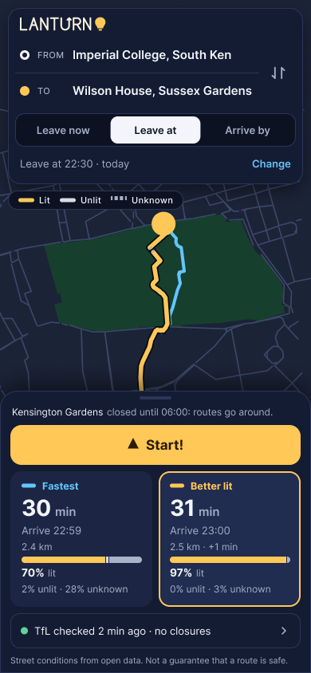 | 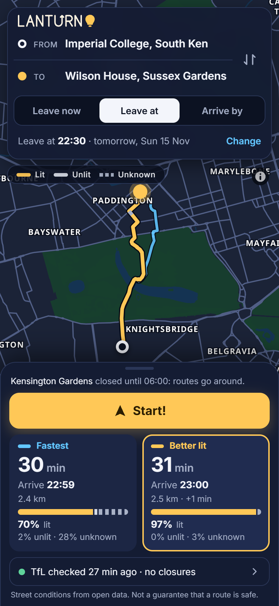 |
| 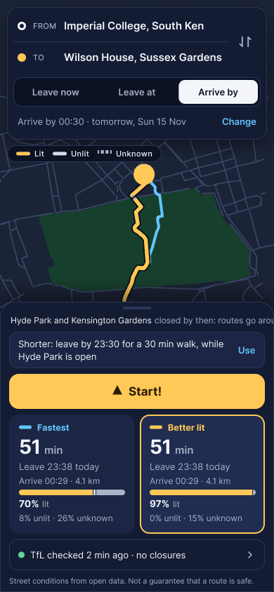 | 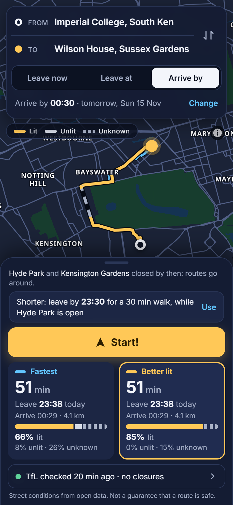 |
|  | 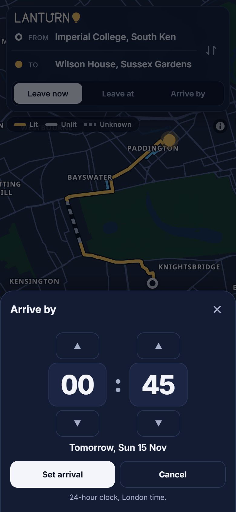 |
| 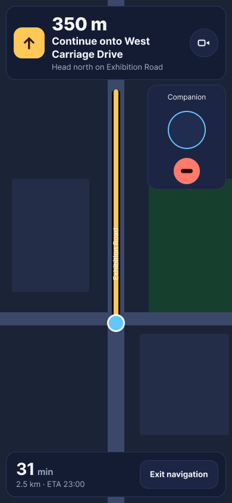 | 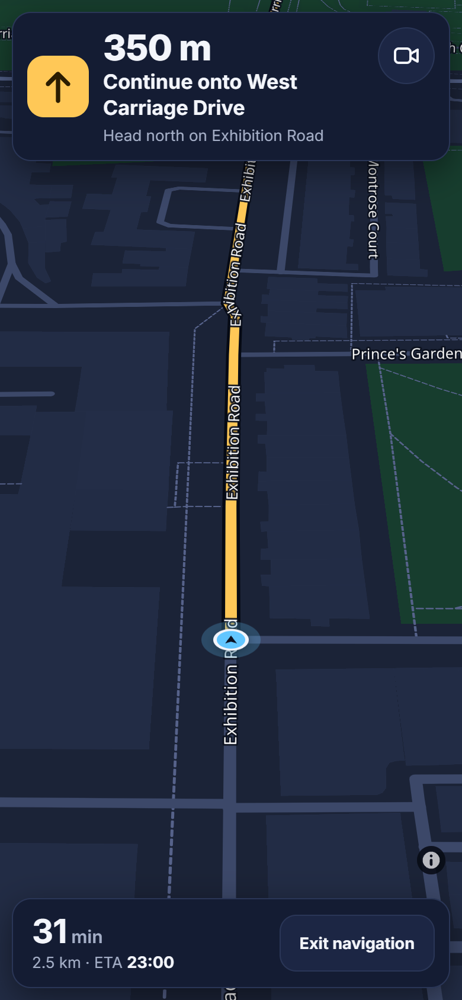 |
| 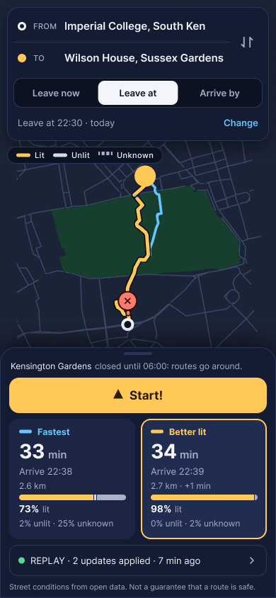 |  |
|  |  |

## What is in the file

**Page "Route comparison flow"**: six screens built from component instances and editable vectors.

1. *01 Plan: compare routes*: Fastest and Better lit side by side, Leave at 22:30, Start above the cards.
2. *02 Demo mode: replay closure applied*: the same journey on the labelled replay data, rerouted around the
   closure. No banner: the status line carries the REPLAY tag and opens the evidence.
3. *03 Evidence: closure applied to routing*: the evidence sheet opened from the status line.
4. *04 Plan: Arrive by 00:30, across midnight*: date roll-over, leave times on the cards, and the hint that an
   earlier departure is a shorter walk.
5. *05 Time picker (24-hour)*: the sheet opened by Leave at and Arrive by.
6. *06 Navigation preview with companion call*: instruction at the top, call window below it at the upper
   right, fixed time, distance and ETA with Exit navigation at the lower right.

Screens 01 to 05 use the app's real route geometry for the 22:30 journey as editable vectors
(`scripts/export_design_map.py`); the map in 06 is a schematic of the start of Exhibition Road.

**Page "Brand"** ([open the logo sheet](https://www.figma.com/design/1GlEqbaZG7xphZQwJ98Tic?node-id=26-513)):
the Lanturn logo sheet (header lockup, wordmark and bulb as separate marks, the header previewed at 390 px,
the bulb and app icon at 24 and 32 px) and a 1280 x 720 demo title card with the line "Your light home".

**Page "Components"**: 22 components, 9 of them variant sets, all bound to variables and text styles.

| Component | Variants / properties | Maps to in `web/` |
|---|---|---|
| Logo / Wordmark | LANTURN as seven editable stroked vectors; the U is a U-turn arrow | part of `web/logo.svg` |
| Logo / Bulb | the amber bulb, a separate mark | part of `web/logo.svg`, `web/icon.svg` |
| Logo / Header lockup | wordmark + bulb | `web/logo.svg`, `.brand` |
| Logo / App icon | bulb on the app background | `web/icon.svg` (favicon, installed app) |
| Trip Header | brand row with the header lockup; text: From, To; nested When Control and time detail row | `#trip` |
| When Control | Mode (Now, Leave at, Arrive by) | `.when` |
| Time Picker | text: hour, minute, resolved date | `.tp` |
| Route Card | Route (Fastest, Better lit) x State (Default, Selected); text: Minutes, Times, Distance, Lit share, Unlit and unknown | `.route` |
| Start Button | | `.start` |
| Status Chip | text: Status (with a Replay tag in demo mode) | `.agent-chip` |
| Map Legend | exactly three entries: Lit, Unlit, Unknown (dashed) | `.legend` |
| Map Marker | Kind (Origin, Destination, Closure, Restriction) | `.mk`, `.mk-x` |
| Nav Instruction | text: Distance, Instruction, Then; turn arrow; call button | `.nav-top` |
| Nav Summary | text: Minutes, Distance and ETA; Exit navigation | `.nav-bottom` |
| Call Window | State (Connecting, Live, Failed) | `.call` |
| Decision Card | text: Record id, Location, Quote, Summary, Meta; nested Tag and Decision Pill | `.dec` |
| Tag | Kind (Replay, Synthetic, Live) | `.tag` |
| Decision Pill | Kind (Closed, Restricted, Neutral); text: Label | `.pill` |
| Button | Kind (Primary, Ghost); text: Label | `.btn` |
| Map Base | vector parks and main roads | basemap (illustrative) |
| Time Chip, Update Banner | marked "V1, retired": kept for reference, not used by any V2 screen | removed from the app |

**Variables**: one collection, "Lanturn", mode "Night": 33 colours (9 of them for the map, 1 for the wordmark),
5 radii, 4 spacing steps and the 44 px touch target, 43 in all. Every variable has explicit scopes and a WEB code syntax naming
the CSS custom property it becomes (`color/route/lit` is `var(--lit)`).

**Text styles**: 14 styles in Inter, from `Display/Nav` (30/34 extra bold) to `Body/Micro` (10.5/14).

## The Lanturn logo

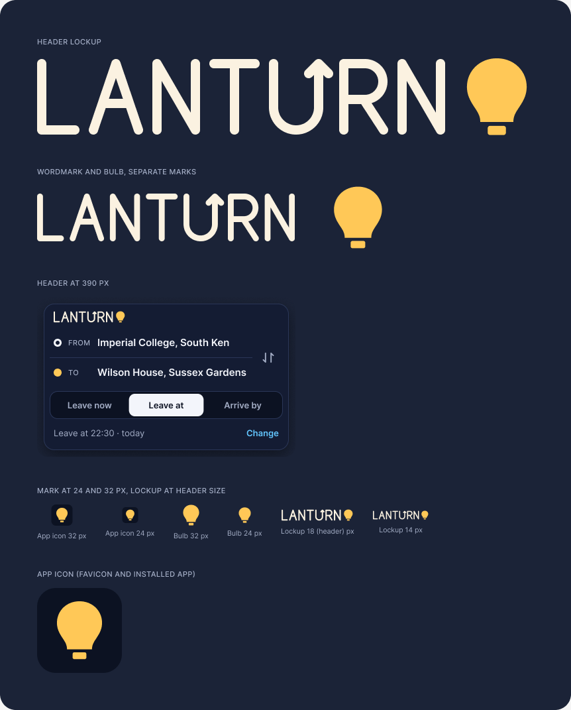

| Header in the app at 390 px | Demo title card |
|---|---|
| 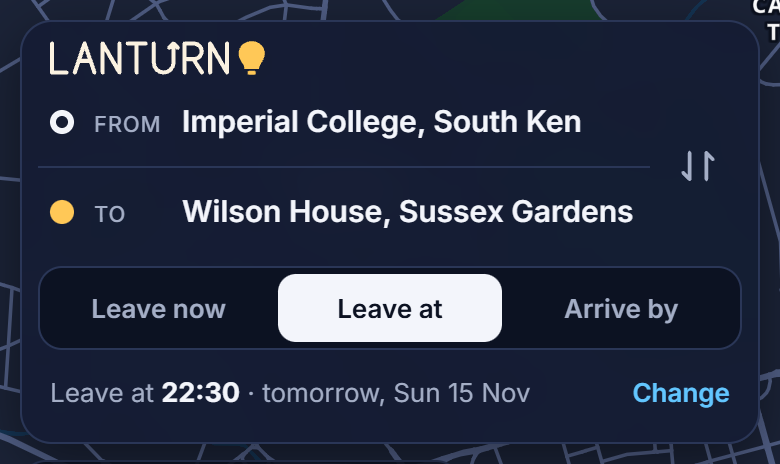 | 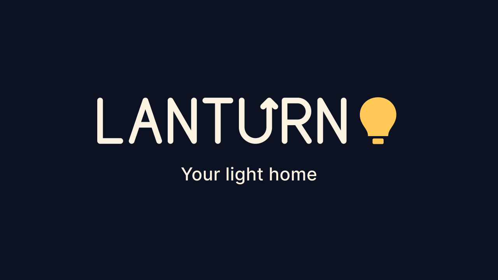 |

- **The name is the idea.** Lanturn, with a U: a lantern that turns you towards home. The U in the wordmark is
  drawn as a U-turn arrow. The left stroke drops, curves round the bottom and rises on the right into a small
  upward arrowhead. The left stem is left plain so it still reads as a U at 14 to 18 px.
- **One stroke weight, round ends.** The seven letters are single-weight strokes with round caps, which keeps the
  hand-drawn character of the team's sketch and stays crisp at header size (the stroke is about 2 px at 18 px tall).
- **The bulb is its own mark.** Amber, flat, with a separate base as in the sketch. It stands just proud of the
  cap height in the lockup and is used alone as the favicon and app icon, where a wordmark would be unreadable.
- **Colours are tokens.** Lettering is `color/brand/wordmark` (a warm white, `--brand-ink`) on the existing dark
  background; the bulb is `color/route/lit`, the same amber as the Better lit route and the Start button.
- **Line: "Your light home".** It says what the product does without promising safety.

How it was made, in order:

1. A team member drew the sketch by hand: the wordmark and a bulb.
2. Claude Code redrew it as vector geometry, written as SVG path data in `scripts/build_brand.py`, and checked it
   at header size in a browser.
3. The same path data was imported into the Figma file through the Figma connector as editable vector layers,
   made into the four Logo components, and bound to the colour variables. The Trip Header component got a brand
   row with the lockup, and the Brand page was laid out with the size previews and the title card.
4. `python scripts/build_brand.py` writes the app's `web/logo.svg` and `web/icon.svg` (and the masters in
   `design/brand/`) from that geometry, taking the two colours from the token export.

So the logo's geometry lives in one script and the Figma components are an editable copy of it. If someone
redraws a letter in Figma, the path data has to be copied back into the script by hand: there is no automatic
export from Figma for the logo.

## Design decisions made in Figma

- **Two cards, side by side, same anatomy.** Time is the largest thing on each card and the lighting bar sits
  directly under it, so the eye compares minutes first and lighting second without reading.
- **Three lighting states, three line styles.** Lit is amber, recorded-unlit is solid light grey, unknown is
  dashed grey, on the card bar, the legend and the route line. The two greys differ by pattern, not only by
  shade, so they still read apart over a dark road or a green park, and unknown can never be mistaken for lit.
- **The route colour identifies the route; the line style says what is known.** Fastest keeps its blue: a blue
  line when it is the alternative, a blue edge around the lighting colours when it is selected. Blue is not in
  the legend because it is an identity, not a lighting state.
- **A lighter night map.** The basemap went from near-black to a dark blue with visibly lighter roads, white
  labels with a dark halo and dark green parks, so a route across open ground is obvious. Routes sit under the
  street names so the names stay readable.
- **Planning is calm.** No explanatory paragraph under the cards and no alarm banner. A verified closure is
  applied to routing and reported in one status line that opens the evidence. The coloured closure marker and
  the Replay tag appear only in demo mode.
- **One prominent action.** Start is the only filled, full-width control on the planning screen and uses the
  Better lit amber, above the cards it acts on.
- **Time is a mode, then a value.** Leave now, Leave at and Arrive by are a three-way control; the chosen time
  and its date ("tomorrow, Sun 15 Nov") sit on their own line, and the picker shows the resolved date before
  the user commits.
- **In navigation, the instruction owns the top.** The call window sits below the instruction, at the upper
  right, so the manoeuvre is never covered. Hang up is the only control on the call and is always visible.
- **Evidence before explanation.** In the evidence card the quoted source sentence comes before the agent's
  summary, because the quote is the part the user can check.
- **Spacing on a 4-point scale and 44 px targets. Inter with tabular figures**, so minutes and percentages line
  up across the two cards.

## How the design reaches the code

```
Figma variables + text styles
   -> design/figma-tokens.json      (exported through the Figma connector)
   -> python scripts/build_tokens.py
   -> web/tokens.css                (generated; the only place colours, radii, spacing and type are defined)
   -> web/styles.css, web/app.js and web/mapstyle.js (use the tokens; map and route colours read them at run time)
   -> python scripts/build_brand.py -> web/logo.svg, web/icon.svg (logo colours taken from the tokens)
```

To change the look: edit the variable in Figma, re-export `design/figma-tokens.json`, run
`python scripts/build_tokens.py`.

## How this was made, stated plainly

The Figma file was built during the hackathon by Claude Code through Figma's connector (variables, components
and screens are native, editable Figma layers, not pasted images). V1 was prototyped in code and then
systematised in Figma. For V2 the token changes (lighting greys, map colours, new type styles) were made in
code and Figma together and are identical in both; the new components and screens were then built in Figma
to match the working app. The logo started as a hand sketch and was drawn as vectors in code, then placed in
Figma as editable components (see "The Lanturn logo"). The team owns and can edit the file. If a judge asks "was it designed in Figma or
coded first", the honest answer is: prototyped in code, systematised and refined in Figma, with Figma the
source of truth for the visual tokens.
