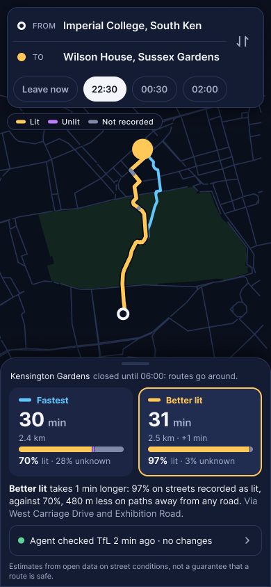
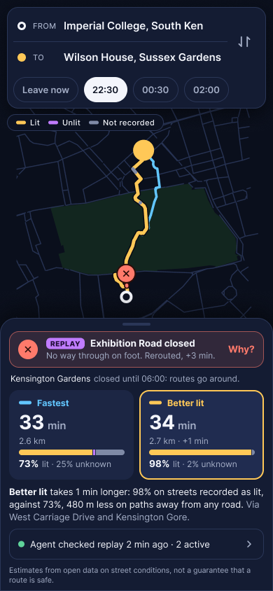
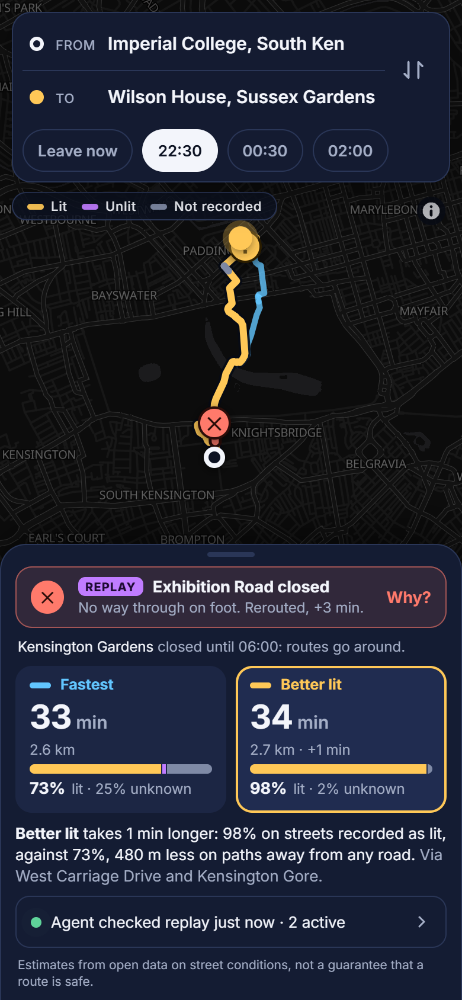
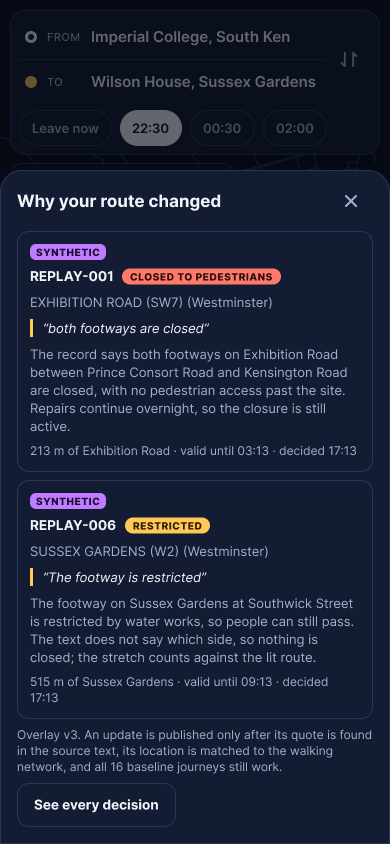
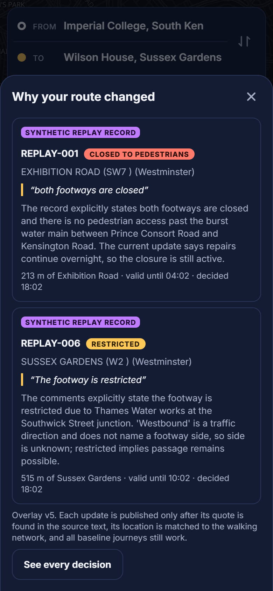

# Design: how Figma is used

**Figma file:** https://www.figma.com/design/1GlEqbaZG7xphZQwJ98Tic
(the owner must set link sharing to "anyone with the link can view" before submitting)

The core flow, comparing two routes and understanding an agent update, was designed in Figma as
variables, components and three composed 390 x 844 screens. The app's colours, radii, spacing and type
are generated from that file, so the design and the product cannot drift apart silently.

| Figma | App |
|---|---|
|  |  |
|  |  |
|  |  |

## What is in the file

**Page "Route comparison flow"**: three screens, built entirely from component instances and editable vectors.

1. *01 Compare routes*: the default state. Fastest and Better lit side by side.
2. *02 Agent update*: the same journey after the agent publishes a closure. Banner, rerouted lines, previous
   route dotted, closure marker.
3. *03 Why your route changed*: the evidence sheet opened from the banner.

**Page "Components"**: 12 components (7 of them variant sets, 20 variants in total), all bound to variables and text styles.

| Component | Variants / properties | Maps to in `web/` |
|---|---|---|
| Route Card | Route (Fastest, Better lit) x State (Default, Selected); text: Minutes, Distance, Lit share, Lighting note | `.route` |
| Update Banner | Action (Closed, Restricted); text: Title, Detail; nested Tag | `.banner` |
| Trip Header | text: From, To; nested Time Chips | `#trip` |
| Time Chip | State (Default, Selected); text: Label | `.time-chip` |
| Agent Chip | text: Status | `.agent-chip` |
| Decision Card | text: Record id, Location, Quote, Summary, Meta; nested Tag and Decision Pill | `.dec` |
| Tag | Kind (Replay, Synthetic, Live) | `.tag` |
| Decision Pill | Kind (Closed, Restricted, Neutral); text: Label | `.pill` |
| Map Legend | | `.legend` |
| Map Marker | Kind (Origin, Destination, Closure, Restriction) | `.mk`, `.mk-x` |
| Button | Kind (Primary, Ghost); text: Label | `.btn` |
| Map Base | vector parks and main roads | basemap (illustrative) |

**Variables**: one collection, "Lantern", mode "Night": 25 colours, 5 radii, 4 spacing steps and the 44 px touch
target. Every variable has explicit scopes and a WEB code syntax naming the CSS custom property it becomes
(`color/route/lit` is `var(--lit)`).

**Text styles**: 12 styles in Inter, from `Display/ETA` (28/31 bold) to `Body/Micro` (10.5/14).

## Design decisions made in Figma

- **Two cards, side by side, same anatomy.** Time is the largest thing on each card and the lighting bar sits
  directly under it, so the eye compares minutes first and lighting second without reading.
- **Three lighting states, never two.** Lit is amber, recorded-unlit is violet, not-recorded is grey, on the
  card bar and on the route line. Grey is deliberately not a paler amber: unknown must not read as "probably lit".
- **The route colour identifies the route; the segment colour says what is known.** Fastest is blue, Better lit
  is amber, and only the selected route shows its lighting breakdown on the map.
- **An update is one banner, in the sheet, above the cards.** It says what changed, what it cost, and carries a
  tag for where the data came from. Replay data is tagged at every level: banner, evidence card, decision log.
- **Evidence before explanation.** In the evidence card the quoted source sentence comes before the agent's
  summary, with a rule in the route colour, because the quote is the part the user can check.
- **Spacing on a 4-point scale and 44 px targets.** Card padding and gaps were normalised to 4/8/12/16 in Figma
  and the app's CSS was changed to match.
- **Inter with tabular figures**, so minutes and percentages line up across the two cards.

## How the design reaches the code

```
Figma variables + text styles
   -> design/figma-tokens.json      (exported through the Figma connector)
   -> python scripts/build_tokens.py
   -> web/tokens.css                (generated; the only place colours, radii, spacing and type are defined)
   -> web/styles.css and web/app.js (use the tokens; map line colours read them at run time)
```

To change the look: edit the variable in Figma, re-export `design/figma-tokens.json`, run
`python scripts/build_tokens.py`.

The map in the Figma screens is real geometry, not a sketch: `scripts/export_design_map.py` projects the
app's actual routes for the demo journey (before and after the replay closure), the two park outlines and the
main roads into a phone frame as SVG, which is imported into Figma as editable vectors bound to the map
colour variables.

## How this was made, stated plainly

The Figma file was built during the hackathon by Claude Code through Figma's connector (variables, components
and screens are native, editable Figma layers, not pasted images), working from a first coded prototype and
then feeding the design decisions above back into the code. The team owns and can edit the file. If a judge
asks "was it designed in Figma or coded first", the honest answer is: prototyped in code, then systematised
and refined in Figma, with Figma now the source of truth for the visual tokens.
